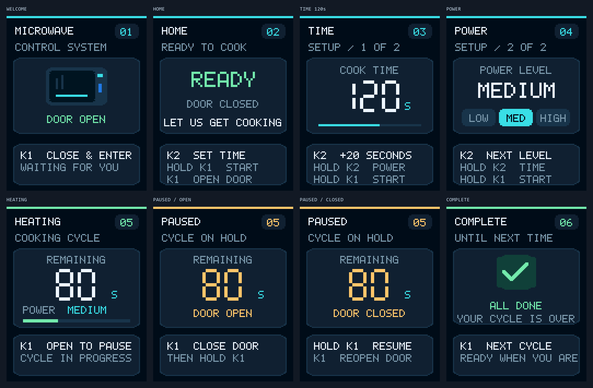

# STM32 微波炉控制演示项目

**仓库版本 v1.5.0**。本版包含串口 Bootloader、三档调功和 30 ℃ 环境过温停机。实机串口验收镜像的 LCD 版本标识为 `FW V1.2`，可用构建脚本的 `--version V1.2 --relay-led-test` 生成。

基于 **STM32F103C8（Cortex-M3）**、**STM32F10x 标准外设库** 和官方 **FreeRTOS Kernel V10.5.1**。输入、控制、提示音、显示和 DHT11 采样由五个静态任务处理，通过队列传递按键事件、蜂鸣命令、采样数据和界面快照。

LCD 上电约 2 秒后进入待机，短按 KEY1 进入主页。界面提供时间、三档功率和运行进度，暂停和停机优先刷新。

常规构建保持 PA2 关闭。启用联调构建可验证 PB10 门反馈和继电器三档通断。Medium 档已完成 5 V PTC 台架带载验证，门反馈使用 PB10 跳线模拟。V1.2 过温停机测试保持 PTC 断电。详见 [实机验收记录](docs/stage1-acceptance.md) 和 [串口升级验收](bootloader/main.md)。

以下预览由实际 ARM 固件的绘图代码输出生成；实物屏幕颜色、方向和流畅度仍需开发板确认。



[查看切换过程预览](docs/ui-transition-preview.png)

## 功能与实现状态

| 功能 | 当前实现 |
| --- | --- |
| 启动界面 | 欢迎页显示约 2 秒后进入待机，短按 KEY1 进入主页 |
| LED 照明 | 常规构建跟随软件门状态，PB10 联调构建跟随门反馈 |
| 门舵机 | PB0 控制 180°门舵机，KEY1 短按切换开关门；运行时开门先停转并暂停倒计时 |
| 转盘 | PA1 控制 360°连续旋转舵机；运行时转动，上电、暂停和完成时保持停止脉宽 |
| 有源蜂鸣器 | PB15 高电平触发。开始或恢复两声，完成三声，异常停机四声，暂停和操作提示一声 |
| 继电器输出 | PA2 普通推挽输出。常规构建关闭，联调构建用 20 秒窗口控制三档，开门、归零及故障时释放 |
| 按键识别 | 两个高电平有效按键，1 ms 独立采样，支持消抖、短按及长按 |
| 时间设置 | 默认 0 秒，以 20 秒为步长设置，范围 0～200 秒，超过 200 秒回到 0 |
| 功率选择 | `Low`、`Medium`、`High` 三档，默认 `Medium` |
| 启动与恢复 | 关门且时间非零时长按 KEY1 启动；暂停后关门并长按 KEY1 恢复 |
| LCD 显示 | 欢迎、待机、主页、时间、档位、运行、暂停、完成及异常停机页面，支持分区动画与增量刷新 |
| 显示传输 | SPI1 硬件 SPI + DMA1 Channel3，128×8 RGB565 条带缓冲，稳定画面不重复传输 |
| FreeRTOS | 官方 V10.5.1，1 kHz Tick，抢占调度，五个静态应用任务及四条静态队列，无动态堆分配 |
| 倒计时与完成 | 按实际经过毫秒计时；归零显示 `COMPLETE`，复位软件门、时间及档位 |
| DHT11 | PA8 / TIM1 输入捕获，每 5 秒采集，LCD 只显示温度。达到 30 ℃ 或读数无效时禁止启动并停止正在进行的倒计时 |
| 门反馈 | 联调构建采样 PB10，闭合后允许启动，断开后暂停。跳线实测通过，实体门开关待验收 |
| 固件升级 | USART1 RX DMA 分包接收，Flash 写后校验。已通过串口升级、中断后重传及新 APP 启动验收 |

联调构建的 LCD 显示 PA2 输出命令；触点动作在实机测试中观察。

## 开发环境与工程配置

| 项目 | 配置 |
| --- | --- |
| 主控 | STM32F103C8 |
| 工程入口 | `project.uvprojx` |
| 构建目标 | `Target 1` |
| 编译器 | 工程记录为 ARM Compiler 5，`V5.06 update 5 (build 528)` |
| 器件支持包 | 工程记录为 `Keil.STM32F1xx_DFP.2.2.0` |
| 固件库 | STM32F10x Standard Peripheral Library V3.5.0 |
| RTOS | FreeRTOS Kernel V10.5.1，ARMCC5 / RVDS Cortex-M3 官方移植层 |
| 启动文件 | `start/startup_stm32f10x_md.s` |
| 外部晶振 | 源码默认 `HSE_VALUE = 8000000`，即 8 MHz |
| 系统时钟 | 目标配置为 HSE × 9 = 72 MHz |
| 总线时钟 | HCLK、PCLK2 为 72 MHz，PCLK1 为 36 MHz；TIM2、TIM3 时钟为 72 MHz |
| Flash | 起始地址 `0x08000000`，大小 `0x10000`（64 KB） |
| SRAM | 起始地址 `0x20000000`，大小 `0x5000`（20 KB） |
| 头文件路径 | `start`、`user`、`bsp`、`library`、`third_party/FreeRTOS/include`、`third_party/FreeRTOS/portable/RVDS/ARM_CM3` |
| 系统异常 | SysTick、SVC、PendSV 由 FreeRTOS 移植层提供；优先级分组为 `NVIC_PriorityGroup_4` |
| CubeMX | 当前项目未包含 `.ioc` 文件；外设通过标准外设库在代码中配置 |

工程同时包含 VS Code/EIDE 配置；当前 EIDE 已配置 AC5、`STM32F10X_MD` 和 ST-Link。

## 硬件与引脚映射

本阶段使用 STM32F103C8 开发板、PC13 低电平有效 LED、两个高电平有效三脚按键模块、ST7735 TFT 屏幕、180°门舵机、360°转盘舵机、高电平触发有源蜂鸣器模块及下载器。若开发板已有 PC13 板载 LED，无需额外连接。继电器仅检查关闭状态，PTC 不接入。

| 模块 | 信号 | MCU 引脚 | 配置与说明 |
| --- | --- | --- | --- |
| KEY1 | 软件开关门、启动/恢复 | PB12 | 下拉输入，按下高电平，释放低电平 |
| KEY2 | 时间及功率设置 | PB1 | 下拉输入，按下高电平，释放低电平 |
| LED | 腔体照明演示 | PC13 | 2 MHz 推挽输出，低电平点亮；开门亮、关门灭 |
| 门锁舵机 | PWM | PB0 / TIM3_CH3 | 50 Hz；开门 0°，关门 90° |
| 转盘舵机 | PWM | PA1 / TIM2_CH2 | 50 Hz；运行脉宽 1000 μs，停止脉宽 1500 μs |
| 继电器控制 | IN | PA2 | 2 MHz 普通推挽输出，低电平关闭，本阶段禁止吸合 |
| 有源蜂鸣器 | IN / S | PB15 | 高电平响；每声 200 ms，间隔 150 ms |
| LCD | CLK / SCK | PA5 | SPI1 硬件时钟 |
| LCD | SDA / MOSI | PA7 | SPI1 硬件数据输出 |
| LCD | RS / DC | PB7 | 低电平为命令，高电平为数据 |
| LCD | RST | PB8 | 屏幕复位 |
| LCD | CS | PB9 | 屏幕片选 |

LCD 驱动面向 1.8 英寸、128×160 的 ST7735 屏幕，接线与原工程一致。SPI1 使用模式 3、8 位、MSB 先行，72 MHz 总线默认 8 分频为 9 MHz；DMA1 Channel3 发送像素，不需要 MISO。显示任务独占 SPI/DMA。背光 BLK 为常亮接法，无独立的软件调光控制。屏幕供电及背光接法应以实际模块规格为准。

两个按键模块均为 VCC 接 3V3、GND 接公共 GND；KEY1 的 OUT 接 PB12，KEY2 的 OUT 接 PB1。模块必须支持 3.3V 供电和输出电平。按下时 OUT 为高，释放为低，不使用原手册的低电平按键逻辑。

双舵机和 5V 模块使用外部稳定 5V 电源，与控制板共地，负载电流不经过开发板 3.3V 稳压器。USB 给控制板供电时，不直接并联外部 5V 至板上 5V。舵机 VCC 接外部 5V、GND 接公共地、SIG 分别接 PB0 和 PA1。第一次测试应先脱离机械连杆，校准门位置及转盘停止点。

三脚有源蜂鸣器 VCC 按模块额定值供电、GND 共地、IN 接 PB15；裸两脚蜂鸣器需晶体管驱动。继电器 VCC 接外部 5V、GND 共地、IN 接 PA2，模块必须支持 3.3V 高电平触发，否则增加电平驱动。5V 供电并不代表兼容 3.3V 输入。PA2 建议外接 10 kΩ 下拉以覆盖复位期间的高阻窗口，阻值应结合模块输入电路核对。本版从初始化开始保持 PA2 关闭，未实现带载调功。

### PWM 参数

TIM2 与 TIM3 均使用 `PSC = 71`、`ARR = 19999`。在定时器时钟为 72 MHz 时：

```text
计数频率 = 72 MHz / (71 + 1) = 1 MHz
PWM 周期 = (19999 + 1) / 1 MHz = 20 ms
PWM 频率 = 50 Hz
```

| 模块或档位 | 比较值 / 脉宽 | 说明 |
| --- | --- | --- |
| 门锁舵机 | 500～2500 μs | 对应代码中的 0～180°；90°为 1500 μs |
| 转盘停止 | 1500 μs | 连续旋转舵机停止设定值 |
| 转盘运行 | 1000 μs | 连续旋转舵机运行设定值 |
| 加热关闭 | PA2 = 0 | GPIO 低电平，不使用 PWM |

TIM2 仅服务转盘，TIM3 仅服务门舵机，各自初始化一次。加热已脱离 TIM2，机械继电器不得接收 50 Hz PWM。连续旋转舵机的停止点及转向需要按实际器件校准；停止比较值在下一个 PWM 帧边界生效，不能把寄存器更新当作机械立即停止。

## 目录与软件分层

```text
.
├── user/                   应用层
│   ├── main.c              LED、优先级分组、时基与按键初始化，启动调度器
│   ├── app.c/.h            软件门、参数、倒计时及页面业务状态机
│   ├── app_rtos.c/.h       输入、控制、蜂鸣器和显示任务，静态队列及诊断
│   ├── ui.c/.h             分层页面、条带绘图与切换动画
│   ├── FreeRTOSConfig.h    静态内存、Tick 和中断优先级配置
│   ├── rtos_hooks.c/.h     空闲任务内存、按键 Tick hook 和故障处理
│   ├── stm32f10x_conf.h     标准外设库配置
│   └── stm32f10x_it.c/.h    保留的芯片异常处理
├── bsp/                    板级驱动层
│   ├── delay.c/.h          FreeRTOS 毫秒时基、任务延时与 DWT 微秒延时
│   ├── key.c/.h            双键独立消抖、短长按事件队列
│   ├── led.c/.h            LED 控制
│   ├── servo.c/.h          门锁舵机控制
│   ├── turntable.c/.h      转盘控制
│   ├── heater.c/.h         继电器安全关闭，第一阶段禁止加热
│   ├── outputs.c/.h        门、转盘及加热关闭顺序，故障停机
│   ├── buzzer.c/.h         PB15 非阻塞提示音状态机
│   ├── lcd.c/.h            ST7735 硬件 SPI、DMA、行缓冲与超时处理
│   └── exti.c/.h           外部中断配置，当前主流程未调用
├── library/                STM32F10x 标准外设库
├── start/                  CMSIS、启动文件及系统时钟配置
├── third_party/FreeRTOS/    官方内核、移植层、MIT 许可及来源说明
├── docs/                   绘图预览与集成验证记录
├── .cmsis/                 配套器件及头文件资源
├── .eide/                  EIDE 工程配置
├── .vscode/                编辑器及构建任务配置
├── Objects/                Keil 编译输出目录
├── Listings/               Keil 列表与映射输出目录
├── build/                  EIDE 编译输出目录
├── project.uvprojx         Keil 工程
├── project.uvoptx          Keil 调试等选项
├── project.code-workspace  VS Code 工作区
└── README.md               项目说明
```

应用层分别管理运行状态与页面状态，BSP 提供 GPIO、按键、LED 及显示接口，启动层负责中断向量、运行环境及系统时钟初始化。官方内核来源与固定 commit 见 [SOURCE.md](third_party/FreeRTOS/SOURCE.md)，内核源码保持官方原文。

| 任务 | 优先级 | 栈（32 位字） | 职责 |
| --- | --- | --- | --- |
| Input | 3 | 192 | 每 1 ms 消费双键事件并发送输入队列 |
| Control | 4 | 384 | 最长等待输入 10 ms，处理业务、执行机构、LED 和倒计时，发布最新快照 |
| Buzzer | 2 | 192 | 空闲阻塞等待提示命令，播放时每约 10 ms 更新响/静音状态 |
| Display | 1 | 512 | 初始化并独占 LCD，每约 10 ms 推进绘图和动画 |
| Sensor | 1 | 192 | 每 5 秒采集 DHT11 并发布读数与状态 |
| Idle | 0 | 128 | 内核空闲任务 |

SysTick 的 FreeRTOS Tick hook 每 1 ms 调用 `KEY_Tick1ms()`。输入队列保存 12 组事件，界面快照和蜂鸣器命令队列各保留最新一个元素。控制任务独占业务状态和正常执行机构命令，显示任务只消费值副本，动画及提示音期间按键和倒计时继续处理。

UI 使用静态 128×8 RGB565 条带缓冲（2048 字节），LCD 使用 256 字节行缓冲，每次刷新最多两条带。页面稳定时不发送像素；数值、提示和进度变化仅刷新相关区域。LCD 初始化的毫秒等待使用 `vTaskDelay()` 让出 CPU，欢迎页通过事件等待 KEY1。

## 编译与下载

串口升级使用独立构建。按 [Bootloader 构建与接线](bootloader/main.md) 生成首装用的 `bootloader.hex` 和串口升级用的 `app.bin`。现有 Keil/EIDE 目标可继续通过 ST-Link 独立下载。

使用 `--version V1.3 --heating-app` 生成 `heating-app.bin`。加热 APP 在 STM32 上运行，可通过现有 Bootloader 串口上传。能控制的功能包括按键倒计时、三档继电器调功、PB10 开门暂停、DHT11 过温关断和手动停止。

### 在 Keil 中构建并下载加热版

1. 重新打开 `project.uvprojx`，在目标下拉框选择 **V1.3 Heating**，然后点击 **Build**。
2. 构建完成后，`build/keil-heating/factory.hex` 包含 Bootloader、加热 APP 和启动校验记录。
3. 保持 PTC 断电并接好 ST-Link，点击 **Flash → Download**。Keil 调用 STM32CubeProgrammer 写入同一份完整镜像、校验后复位。LCD 开机画面应显示 `FW V1.3`。

构建需要 ARMCC5、Windows PowerShell 和 Python 3。下载使用 PATH 上、ST 默认安装目录中或 EIDE 已安装的 `STM32_Programmer_CLI.exe`。`Target 1` 是从 `0x08000000` 写入的演示目标，下载它会覆盖 Bootloader 所在区域。

Windows 图形上位机可选择 COM 口和 BIN，显示写入进度及整包校验结果。见 [上位机使用与打包说明](tools/firmware_updater.md)。

### Keil MDK

1. 安装 Keil MDK、ARM Compiler 5 和 STM32F1 器件支持包。工程记录的版本见上表；更换工具链后需重新验证兼容性。
2. 打开 `project.uvprojx`，选择 `Target 1`，核对器件为 `STM32F103C8`、Flash 为 64 KB、SRAM 为 20 KB。
3. 在 **Options for Target → C/C++ → Define** 中核对预处理宏为 `USE_STDPERIPH_DRIVER,STM32F10X_MD`，当前工程已配置这两个宏。
4. 核对头文件搜索路径包含上表所列路径，工程中包含四个 FreeRTOS 编译文件和新应用文件，执行 **Rebuild**，根据实际日志处理错误及警告。
5. Keil 输出目录配置为 `Objects/`，输出名为 `project`，可执行文件为 `project.axf`。当前未启用 **Create HEX File**；如需 HEX，请在 **Options for Target → Output** 中勾选后重新构建。
6. 在 **Debug** 和 **Utilities** 中选择实际下载器，检查 Flash 下载算法。项目调试选项中存在 ST-Link 配置，使用前应核对本机驱动及设备连接。
7. 使用 SWD 下载时，将 SWDIO 接 PA13、SWCLK 接 PA14，并连接 GND 和下载器要求的目标参考电压；按需连接 NRST。执行 **Download**，完成后复位运行。

系统时钟代码依赖 8 MHz 外部晶振正常起振。工程器件配置中的 `CLOCK(12000000)` 元数据与源码配置不同，运行时的目标时钟应以 `start/system_stm32f10x.c` 及实际硬件为准。

### VS Code / EIDE

可通过 `project.code-workspace` 打开工作区，现有任务包括 `build`、`flash`、`build and flash`、`rebuild` 和 `clean`，均依赖 EIDE 插件命令。

当前 `.eide/eide.yml` 使用 AC5 工具链，已接入 FreeRTOS、应用层、执行机构及新蜂鸣器文件，包含 `STM32F10X_MD` 宏，并选用 ST-Link/SWD 下载。需按本机情况设置编译器、下载器驱动及连接。EIDE 构建输出为 `build/Target 1/project.axf` 和 `build/Target 1/project.hex`。修改后应重新构建，再将最新固件下载到开发板验证。

## 操作说明

消抖约 20 ms。短按在释放并消抖后生效；长按在稳定按住约 1 秒后立即生效，释放不会再触发短按。上电一直按住的键必须先释放再按。

| 当前页面 | 操作 | 结果 |
| --- | --- | --- |
| 欢迎／开门待机 | 不操作 | 一直停留，LED 亮；不显示时间与档位设置 |
| 欢迎／开门待机 | 短按 KEY1 | 软件门关闭、LED 灭，进入主页 |
| 主页 | 短按 KEY2 | 进入时间设置，本次不增加时间 |
| 主页 | 长按 KEY2 | 提示先短按 KEY2 进入时间设置，不越过菜单层级 |
| 时间设置 | 短按 KEY2 | 时间增加 20 秒；200 秒后再加一次回到 0 秒 |
| 时间设置 | 长按 KEY2 | 进入档位设置 |
| 档位设置 | 短按 KEY2 | 档位循环；从默认 Medium 开始，依次为 High、Low、Medium |
| 档位设置 | 长按 KEY2 | 返回时间设置 |
| 主页／时间／档位设置 | 短按 KEY1 | 软件开门、LED 亮，返回欢迎页；保留已设时间和档位 |
| 主页／时间／档位设置 | 长按 KEY1 | 时间大于 0 时进入运行页；0 秒时提示 `Set time first` |
| 运行 | 短按 KEY1 | 软件开门、LED 亮，进入暂停页并保留剩余毫秒 |
| 暂停，软件门打开 | 短按 KEY1 | 软件关门、LED 灭，仍停留在暂停页 |
| 暂停，软件门关闭 | 长按 KEY1 | 恢复剩余倒计时，返回运行页 |
| 软件门打开 | 长按 KEY1 或操作 KEY2 | 提示 `Close door first`，不跳到设置或运行页 |
| 正在运行 | 长按 KEY1 | 提示 `Already running`，不重复启动 |
| 运行或暂停 | 操作 KEY2 | 保持本轮设置，显示相应操作提示 |
| 倒计时归零 | 自动处理 | 进入完成页，软件门打开、LED 亮，时间恢复 0、功率恢复 Medium |
| 完成 | 短按 KEY1 | 软件关门、LED 灭，进入主页开始新一轮 |

例如，设置 60 秒、Medium 档：上电欢迎页短按 KEY1 进入主页，短按 KEY2 进入时间页，再短按三次 KEY2，保留默认功率，最后长按 KEY1 进入运行页。运行中短按 KEY1 开门并进入暂停页，再短按关门，长按恢复；归零进入完成页，短按 KEY1 回主页设置下一轮。

页面路径为：`欢迎 → 主页 → 时间设置 ⇄ 档位设置 → 运行 ⇄ 暂停 → 完成`。主页仅提供入口，时间页只突出时间，档位页只突出档位；运行页才同时显示剩余时间与当前档位。

## 当前限制与维护说明

- 常规构建的 `Heater_SetPower()` 保持 PA2 关闭。联调构建由控制任务处理 PB10 门反馈和 DHT11 环境温度。持续转动待连续旋转舵机实测。
- 运行及暂停期间锁定时间、功率设置，以保存本轮剩余时间；关门后需长按 KEY1 恢复，不能通过长按 KEY1 直接暂停，应短按开门暂停。
- 两键同组送达时，KEY1 优先，该组 KEY2 事件被忽略。每键驱动环形队列最多保留 7 个事件，满时丢弃新事件；Input 每 1 ms 消费，跨任务输入队列若满则记录故障并停止。
- SysTick 由 FreeRTOS 独占。`delay_ms()` 只允许在线程中使用；调度器运行后使用任务延时，启动前使用 DWT 忙等，不可在 ISR 内调用。
- `EXTIX_Init()` 虽然存在于 BSP 中，但 `main()` 未调用，当前按键由 FreeRTOS Tick hook 每 1 ms 读取 GPIO 并生成事件。
- SPI 或 DMA 等待超时会记录 `lcd_fault_code`；任务、队列、断言、栈溢出及 HardFault 等故障先关闭继电器、停止转盘并静音，再通过 `rtos_fault_code` 诊断并点亮 LED 后停止，不自动移动门。实机需检查舵机校准、屏幕颜色、偏移、SPI 信号质量和各应用任务的栈余量。
- 部分源文件中文注释存在编码异常。维护时应先确认原文件编码，避免批量转码造成额外变化。

修改参数时，可从以下位置查找：

| 参数 | 位置 |
| --- | --- |
| 时间步长、上限及默认功率 | `user/app.c`：`TIME_STEP`、`TIME_MAX`、`App_Init()` |
| 任务周期、栈和队列容量 | `user/app_rtos.c` |
| RTOS Tick、静态内存和中断优先级 | `user/FreeRTOSConfig.h` |
| 界面颜色、布局与动画 | `user/ui.c` |
| 长按与消抖阈值 | `bsp/key.h`：`KEY_LONG_MS`、`KEY_DEBOUNCE_MS` |
| 按键、LED 引脚 | `bsp/key.h`、`bsp/led.h` |
| 门锁开关角度 | `bsp/servo.h`：`SERVO_ANGLE_OPEN`、`SERVO_ANGLE_CLOSE` |
| 转盘运行及停止脉宽 | `bsp/turntable.h`：`TURNTABLE_PULSE_RUN`、`TURNTABLE_PULSE_STOP` |
| 蜂鸣器节奏 | `bsp/buzzer.h`：`BUZZER_ON_MS`、`BUZZER_GAP_MS` |
| 加热关闭约束 | `bsp/heater.c`：所有接口保持关闭，历史档位宏不再驱动输出 |
| LCD 引脚及显示偏移 | `bsp/lcd.c`：引脚宏、`LCD_X_OFFSET`、`LCD_Y_OFFSET` |
| LCD 尺寸 | `bsp/lcd.h`：`LCD_W`、`LCD_H` |
| LCD SPI 速度 | `bsp/lcd.c`：`LCD_SPI_PRESCALER` |

按项目协作约定，后续新增或修改 `.c` 文件时，应同步维护同目录、同名的 `.md` 说明文件。
