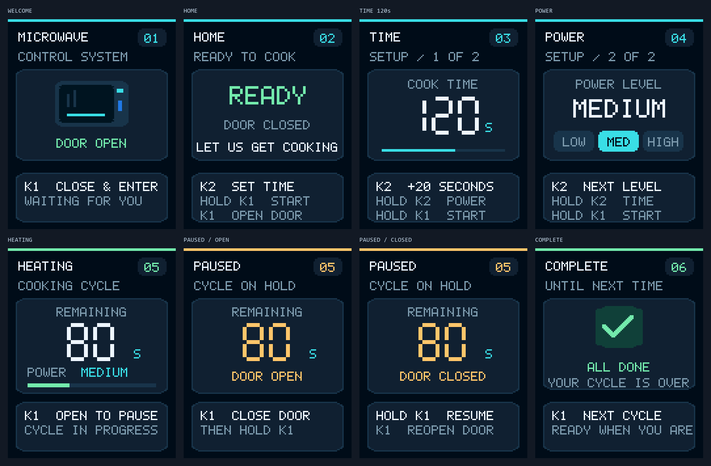
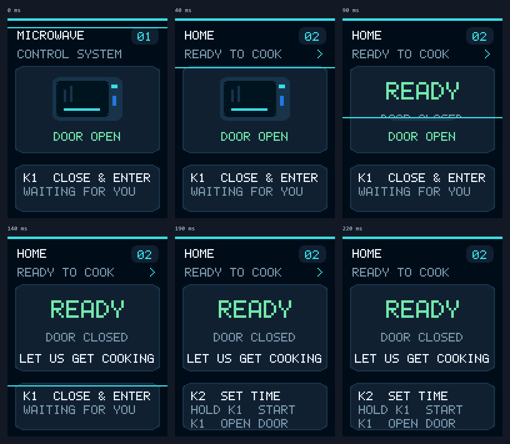

# UI 与 FreeRTOS 迁移验证记录

验证日期：2026-11-10。目标 STM32F103C8，64 KiB Flash、20 KiB SRAM，ARM Compiler 5.06 update 5（build 528）。本记录区分编译、指令级仿真与实机结果；本版尚未烧录验证。

## 构建与来源

- 最终完整重建包含 43 个 C 文件、1 个汇编文件，成功生成 AXF 和 HEX。Keil、EIDE 配置的 44 个源文件与实际构建输入一致，两个 FreeRTOS 头文件路径已核对。
- 最终 Code 16992、RO data 508、RW data 148、ZI data 9020 字节。Flash 镜像为 **17648 字节**，静态 RAM 占用为 **9168 字节**，分别占器件容量的 26.9% 和 44.8%。任务栈、条带缓冲均包含在静态 RAM 数字内。
- 官方 FreeRTOS Kernel V10.5.1 的 23 个 C/H 文件与下载的官方固定版本逐字节一致。版本来源见 [SOURCE.md](../third_party/FreeRTOS/SOURCE.md)，文件哈希见 [SHA256SUMS](../third_party/FreeRTOS/SHA256SUMS)。
- 所有本次新增或修改的 14 个 C 文件都具有同目录、同名 Markdown 说明。
- 对 HEX 全部记录验证长度、校验和、Flash 地址范围及结束记录；数据为 17648 字节，地址范围 `0x08000000`～`0x080044EF`。
- HEX 文件 SHA-256：`4622aeee548b97eec75e54589f8676b916e41c9d05bca9ae37416e25bceae59d`。再次构建后请以实际产物为准。

## 应用、按键与 UI

用 Python、Unicorn（ARM MCLASS/Thumb）和 pyelftools 加载实际 ARMCC AXF，执行真实应用、按键、UI 的机器指令，79 项断言通过。UI 验证在 `LCD_Blit()` 边界捕获 RGB565 条带，重建图片，不替换 UI 绘图代码。

覆盖内容：

- PC13 上电点亮、2 MHz 推挽输出；欢迎页等待 10 分钟仍不自动跳转，仅短按 KEY1 进入并熄灯。
- KEY1/PB12、KEY2/PB1 的高电平有效输入、20 ms 消抖、短按、长按单次触发、长按释放不补发短按、上电按住须释放后重置。
- 时间 20 秒步长、200 秒上限及回零；三档功率循环；菜单层级；运行和暂停期间禁止改参数；同组双键 KEY1 优先。
- 倒计时保存毫秒、显示秒数向上取整、暂停冻结、关门后长按恢复、完成复位、系统 Tick 回绕及提示期限。
- 欢迎、主页、时间、功率、运行、暂停开门、暂停关门、完成共 8 种显示状态。
- 每个动画步骤最多传输两条带；切换后与全新绘制的像素完全一致，无扫描前沿或箭头残留；快速导航收敛到最新页面；暂停可打断运行页切换。
- 稳定快照及无可见变化的毫秒更新不发送像素；倒计时局部更新与全新绘制结果一致。
- 向量表中的 SVC、PendSV、SysTick 指向链接后的官方移植层；三个任务及静态任务、队列创建函数已链接。

另执行实际 `main()`：确认 LED 初始化最先发生，然后设置 `NVIC_PriorityGroup_4`、更新 72 MHz 时钟与 DWT、配置两个按键下拉输入，再进入 `AppRTOS_Start()`。启动前没有自行启用 SysTick。

页面预览来自上述实际机器指令输出，放大使用最近邻算法：

## FreeRTOS 调度仿真

执行官方内核、实际任务函数、队列及 PendSV 保存恢复汇编。Unicorn 没有完整 NVIC 外设，因此由验证程序模拟异常进入/返回栈帧、周期 Tick 注入及 STM32 的四位中断优先级寄存器；LCD 硬件初始化和像素发送在边界替代，UI 绘图仍执行。本项不等同于实机调度或实时性能测试。

完整操作序列为：欢迎 → 主页 → 时间 → 功率 → 时间 → 启动 → 倒计时 → 开门暂停 → 关门 → 长按恢复 → 完成。

| 观察项 | 仿真结果 |
| --- | --- |
| 模拟时间 | 27020 ms |
| 上下文切换 | 59446 次 |
| 实际创建任务 | Input、Control、Display、Idle，共 4 个 |
| 内核时钟配置 | 72 MHz / 72000 = 1 kHz；PendSV、SysTick 优先级 15 |
| Input / Control / Display 循环 | 27020 / 2703 / 2702 |
| 输入队列溢出 | 0 |
| 三任务最小剩余栈（字） | 163 / 221 / 438 |

运行中三个任务持续推进，约 1500 ms 的等待正确扣减倒计时；暂停时剩余毫秒不变，恢复后可完成本轮。由于 LCD 外设被替代，上述栈余量仅覆盖仿真路径，不能作为真实 SPI/DMA 路径的栈余量保证。

## LCD 驱动仿真

另外执行当前 AXF 的 `LCD_Blit()`、辅助函数及标准外设库寄存器代码，28 项检查通过。SPI 就绪标志、DMA 完成及系统时间由 MMIO 模型提供，未替换被测绘图传输函数。

- SPI 模式 3、8 分频、单线发送，DMA 目的地址与字节宽度正确。
- RGB565 高字节先发；每行 DMA 字节数和窗口包含式终点坐标正确；128 像素全宽不超过 256 字节行缓冲。
- 同时裁剪右侧和底部时仍按原始源宽度跨行；零尺寸和超界坐标不发送数据。
- SPI TXE/BSY 超时、DMA 完成超时及 DMA 传输错误分别记录故障码；退出时释放 CS、关闭 SPI 与 DMA，并拒绝后续绘图。

此项覆盖驱动分支和寄存器操作，不验证物理总线及屏幕时序。

## 开发板验收

仍需在实际硬件确认屏幕方向、RGB/BGR 色序、偏移、9 MHz SPI 信号质量、DMA 发送、真实动画流畅度及任务栈余量。建议按下列顺序验证：

1. 复位后 LED 立即亮，屏幕初始化后保持欢迎页；不按键持续观察，不能自动跳页。
2. 短按 KEY1，LED 灭，进入主页；KEY2 分别测试进入时间、加时、长按切功率及返回。
3. 设置 20 秒并长按 KEY1，确认运行页、进度与倒计时；短按开门应亮灯暂停，关门后保持暂停，长按恢复。
4. 在切换中操作按键，确认业务输入及时生效；完成后亮灯、复位时间和档位，KEY1 可开始下一轮。
5. 用调试器观察 `rtos_fault_code`、`lcd_fault_code`、`app_diagnostics` 的队列溢出及最小剩余栈。实际操作中应无故障，三个任务循环持续增加。

当前只接入屏幕、按键和 LED；加热、电机与门锁没有启用。
